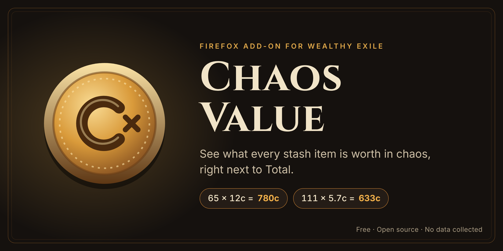
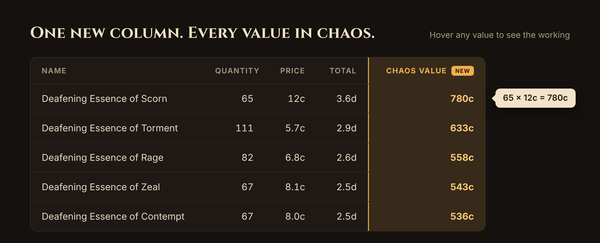

<p align="center">
  
</p>

<p align="center">
  <a href="https://github.com/viexhd/wealthy-exile-chaos-value/actions/workflows/ci.yml"></a>
  <a href="https://github.com/viexhd/wealthy-exile-chaos-value/releases/latest"></a>
  
  
  <a href="LICENSE"></a>
</p>

<p align="center">
  <a href="#install"><b>Install</b></a> &nbsp;·&nbsp;
  <a href="#what-it-does"><b>Features</b></a> &nbsp;·&nbsp;
  <a href="#how-the-divine-rate-is-worked-out"><b>How it works</b></a> &nbsp;·&nbsp;
  <a href="#privacy"><b>Privacy</b></a>
</p>

# Chaos Value for Wealthy Exile

A small Firefox extension that adds a **Chaos Value** column to the stash table on [Wealthy Exile](https://wealthyexile.com).

The site shows each item's Quantity, Price and Total, but the Total is often in divines. This extension adds a column to the right of Total that shows the same value in chaos, so you can compare items at a glance.

<p align="center">
  
</p>

<p align="center"><sub>Example values. The real column takes on the look of the site's own Total column.</sub></p>

## What it does

- Adds a **Chaos Value** column directly to the right of the **Total** column, in the header and in every item row.
- Chaos Value is **Quantity × Price**, shown in chaos. When the site's Total is already in chaos, that Total is used, because the site works it out from the exact price rather than the rounded one it shows.
- Prices in divines (for example `1.2d`) are converted to chaos with the divine rate.
- Values are shown as whole chaos with thousands separators (`780c`, `1,234c`). Values under 10c show 1 decimal place (`5.7c`).
- Hover over a value to see the working, for example `65 × 12c = 780c`.
- Click a value to copy it, ready to paste into the in-game market. The copied value is digits only, with no spaces, commas or "c" (for example `1234`, or `5.7` under 10c). A small "Copied" note appears by your cursor.
- The column copies the look of the Total column, so it fits in with the site.
- The column keeps up with the site as you sort, filter, search, switch tabs, re-sync or scroll. It is removed when you leave the stash page and added again when you come back.
- Columns are found by their header text (Quantity, Price, Total), so the extension keeps working if the site moves columns around.

### Sorting

The Chaos Value header cannot be clicked to sort. The stash table is a virtualised list owned by the site: only the rows on screen exist in the page, and the site rebuilds them as you scroll. Sorting those rows from outside would only reorder what is on screen and would fight with the site's own sorting, so it is left out on purpose. The sort arrow is hidden in the Chaos Value header for the same reason.

## The popup

On Wealthy Exile an icon appears in the address bar. It is hidden on every other website. Click it to open the popup, which has:

- **Show the Chaos Value column**: turn the column on or off.
- **Detected divine rate**: the rate found on your stash page, and where it came from (read only).
- **Manual divine rate**: type your own rate in chaos to use instead. Click **Clear** to go back to the detected rate.

Changes take effect on the open page straight away. You do not need to reload.

## How the divine rate is worked out

The extension uses the first of these that is available:

1. **Your manual rate**, if you have set one in the popup.
2. **The Divine Orb price shown on the page.** Wealthy Exile lists the Divine Orb price (for example `216c`) in the sidebar, and in the Divine Orb row if you have any. This is the exact rate the site uses.
3. **An estimate from your rows**, if the page shows no Divine Orb price:
   - It looks at every row where the **Price** is in chaos (for example `12c`) and the **Total** is in divines (for example `3.1d`).
   - For each of those rows, the rate is `(Quantity × Price) / Total`.
   - Totals are rounded to 1 decimal place, so a single row can be a little off. The extension takes the **median** of all the rows, which ignores the odd outlier.
   - The stash table only shows the rows on screen, so the extension remembers rows it has already seen while you are on the stash page. Scrolling therefore improves the estimate rather than changing it.

If none of these is available, items priced in divines show **?** with a tooltip explaining why. You can set a rate by hand in the popup to fix this.

### Why some values differ from Quantity × Price

The site rounds the prices it shows (for example `0.04c`), but works out its Total from the exact price. So for cheap items held in large numbers, Quantity × Price can be noticeably off: 960 × `0.04c` is 38c, while the site's Total is 43c. When the Total is in chaos, the extension shows the site's Total, and the tooltip explains the difference. When the Total is in divines (rounded to 1 decimal place), Quantity × Price is the more precise figure, so that is used instead.

## Install

### From Firefox Add-ons (recommended)

Install it from its Firefox Add-ons page:

**https://addons.mozilla.org/firefox/addon/chaos-value-for-wealthy-exile/**

Click **Add to Firefox**. Firefox keeps it up to date for you.

### From a GitHub release

1. Go to the [latest release](https://github.com/viexhd/wealthy-exile-chaos-value/releases/latest).
2. If a signed `.xpi` file is attached, click it in Firefox (or drag it onto a Firefox window) and click **Add**.
3. The `.zip` file attached to each release is unsigned. Release versions of Firefox only install signed add-ons, so use the zip for a temporary install (below), or in Firefox Developer Edition or Nightly with `xpinstall.signatures.required` set to `false` in `about:config`.

### Temporary install (for testing)

1. Download or clone this repository, or download the `.zip` from a release.
2. In Firefox, go to `about:debugging#/runtime/this-firefox`.
3. Click **Load Temporary Add-on...**.
4. Pick `manifest.json` in the repository folder, or the `.zip` file.

The add-on stays installed until you restart Firefox.

### If the column does not appear

- Reload the stash page. Tabs that were open before installing do not have the add-on yet.
- Go to `about:addons`, click **Chaos Value for Wealthy Exile**, open the **Permissions** tab and make sure access to wealthyexile.com is turned on.

Firefox 140 or newer is needed (Firefox for Android 142 or newer).

## Privacy

- The extension collects **no data** at all.
- Nothing leaves your browser. It makes no network requests and has no analytics.
- The only thing it stores is your settings (column on or off, and your manual rate) plus the last detected rate, in Firefox's local extension storage on your own computer.

## Where it runs

The extension **only runs on wealthyexile.com** (including `www.wealthyexile.com`). Its only site access is `*://*.wealthyexile.com/*`, and its only other permission is `storage`. It **cannot read or change any other website**.

On Wealthy Exile it only changes the stash page (any address starting with `/stash`). When you are signed in, the site also shows your stash on its home page, so the column appears there too. On every other Wealthy Exile page it does nothing.

## Development

You need [Node.js](https://nodejs.org) 22.12 or newer. The browser tests also need Firefox installed (set `FIREFOX_PATH` if it is not in the usual place).

```bash
npm install
npm test        # unit tests for the parsing code (node --test)
npm run test:e2e  # browser tests: drives test/fixture.html in headless Firefox
npm run lint    # web-ext lint
npm start       # open Firefox with the extension loaded, at wealthyexile.com/stash
npm run build   # build a zip into dist/
```

To check the column by eye without signing in, open `test/fixture.html` in Firefox. It loads a saved copy of the stash table (`fixtures/stash-table.html`) and the real content script, with buttons that copy what the site does (sorting, reusing rows, re-rendering, leaving the page). `npm run test:e2e` runs the same checks automatically in headless Firefox, and CI runs them on every push. If you change the fixture, run `npm run fixture` to update `test/fixture-data.js`.

### Releasing a new version

1. Update `version` in both `manifest.json` and `package.json`.
2. Add a section for the new version to `CHANGELOG.md`.
3. Commit, then tag and push: `git tag v1.0.1 && git push origin main --tags`.

The [Release workflow](.github/workflows/release.yml) then runs the tests and lint, builds the zip and creates a GitHub release with it. If the repository has the secrets `AMO_API_KEY` and `AMO_API_SECRET` (API credentials from [addons.mozilla.org](https://addons.mozilla.org/developers/addon/api/key/)), it also submits the version to Firefox Add-ons for review. The listing text for Firefox Add-ons is kept in `amo-metadata.json`.

### Code layout

The code is plain JavaScript with no frameworks and no build step:

- `src/parse.js`: reading prices and quantities, working out the divine rate, formatting.
- `src/content.js`: adds and updates the column on the page.
- `popup/`: the address bar popup.

## Disclaimer

This is an unofficial extension. It is not affiliated with, endorsed by or connected to Wealthy Exile or Grinding Gear Games. Path of Exile is a trademark of Grinding Gear Games.

## Licence

[MIT](LICENSE)
